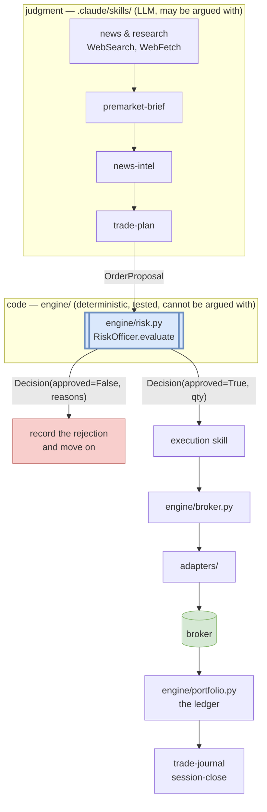
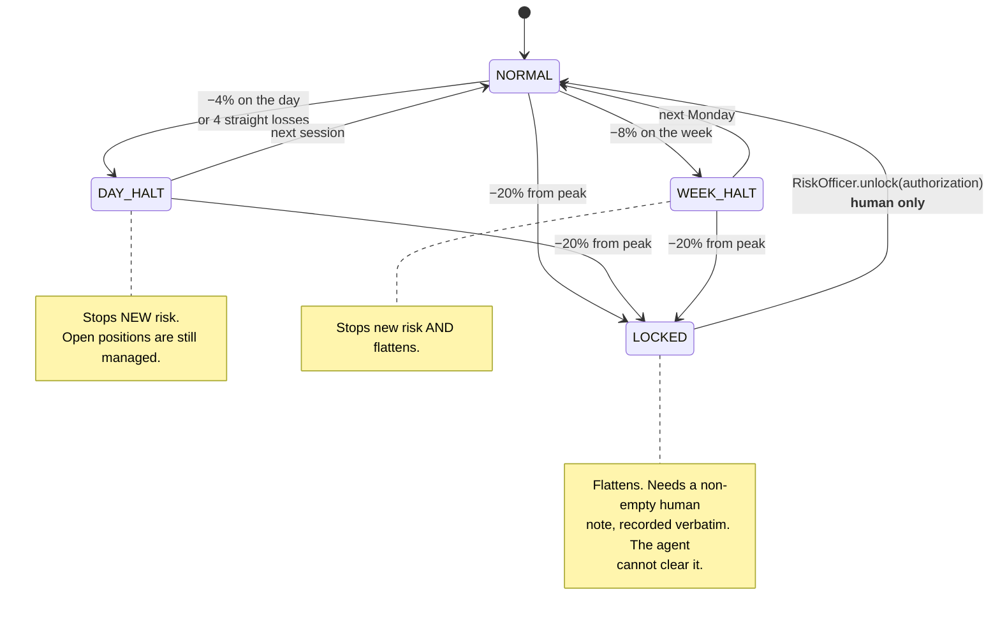
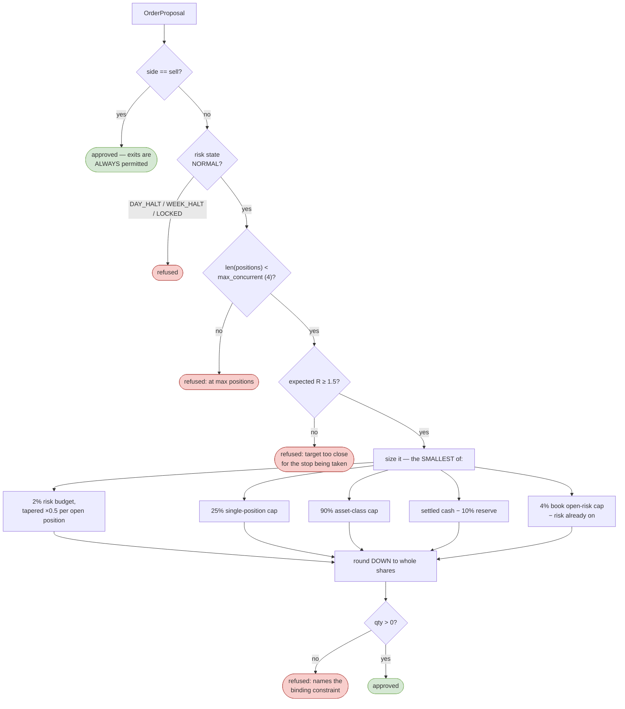

# Architecture

One organizing principle: **the model decides what to trade; code decides
whether it is allowed.**

An LLM can be argued out of a rule — by a persuasive headline, by a losing
streak, by its own fluency. So every rule that protects capital lives in
`engine/`, is deterministic, and is pinned by a test. The skills in
`.claude/skills/` hold judgment: regime reading, news triage, thesis
construction, reflection. They propose. They never execute.

The only path from judgment to a broker runs through one function. There is no
second route, and `RiskOfficer.evaluate` cannot be reached with a proposal it
has not scored. **A rejection is an outcome, not an obstacle** — the correct
response is the left-hand branch, never reshaping the order until it passes.

## Modules

| Path | Responsibility |
|---|---|
| `engine/config.py` | The constitution. Every limit, as data. Changing it is a reviewed act. |
| `engine/risk.py` | The gate. Sizes or rejects every entry; runs the halt state machine. |
| `engine/portfolio.py` | Ledger: cash, positions, realized P&L, T+1 settlement, drawdown. |
| `engine/broker.py` | Paper fills with spread, slippage and fees. |
| `engine/market.py` | Indicators, Black-Scholes, CSV loader, synthetic generator. |
| `engine/sim.py` | Daily-bar simulation with no look-ahead and pessimistic intrabar ordering. |
| `engine/strategies.py` | Mechanical baselines for stressing the engine. Not the live brain. |
| `engine/feasibility.py` | Monte Carlo on the target and on edge sensitivity. |
| `tools/status.py` | Account state. Run before forming any opinion. |
| `tools/review.py` | Expectancy, win rate, profit factor, cost ratio. |
| `sim/run_suite.py` | The Monte Carlo suite and its ablations. |
| `tests/` | The constitution's teeth. |

## The state machine

`DAY_HALT` and `WEEK_HALT` stop new risk; open positions are still managed.
`WEEK_HALT` and `LOCKED` additionally flatten. `LOCKED` requires
`RiskOfficer.unlock(authorization)` with a non-empty human note, recorded
verbatim — the agent cannot clear it.

Exits are approved unconditionally in every state. A risk system that can
block you from closing a position is a risk system that has become the risk.

## What the gate actually checks, in order

Every constraint below is a line in `engine/config.py` with a test behind it.
The order matters: an order refused early is never sized, so the reason given
is the *first* thing that stopped it, not the worst.

Whole-share rounding is the last step and it bites hardest at $300: a tapered
budget that buys 0.4 shares buys none. That is why a refusal names its binding
constraint — "size rounds to zero" alone would send the next session hunting
for a bug that is not there.

## Why the limits are what they are

| Limit | Value | Reason |
|---|---|---|
| Risk per trade | 2% | At $300 that is $6 — small enough that 20 consecutive losses do not end the account |
| Single position | 25% equity | One bad name cannot be the whole story |
| Option position | 15% equity | Premium can go to zero; equity rarely does |
| Crypto aggregate | 20% | 24/7 gap risk while the agent is asleep |
| Concurrent positions | 4 | $300 cannot supervise more, and correlation makes 8 positions one position |
| Cash reserve | 10% | Never fully invested; leaves room to manage |
| Day halt | -4% | Two full stops is a bad read, not bad luck |
| Week halt | -8% | Recoverable; -8% needs +8.7% to get back |
| Drawdown lock | -20% | -20% needs +25% to recover; beyond this, recovery math turns against you fast |
| Option min DTE | 7 | 0DTE is a coin flip with a spread on it |
| Option min equity | $1,500 | Derived in simulation — see `docs/05-sim-report.md` Result 2 |

## Adding a rule

A rule enters the system only with evidence (see the `trade-journal` skill):
five consistent closed trades, or a backtest showing improved median outcome
without a worse ruin rate. Then it goes in `engine/config.py` **and** gets a
test, and the evidence goes in `docs/04-lessons.md`. Rules without an
evidence trail are deleted at the next review.
