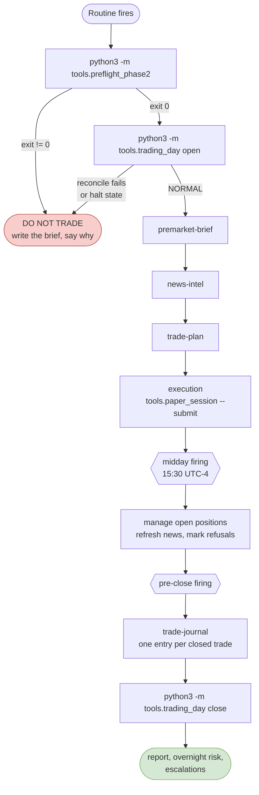
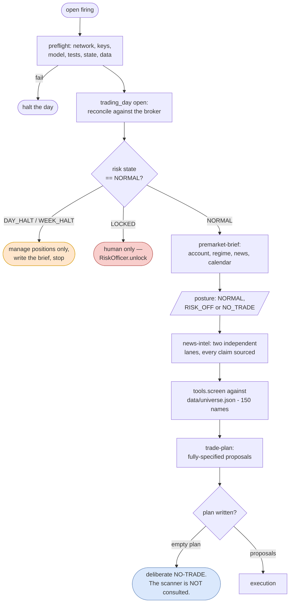
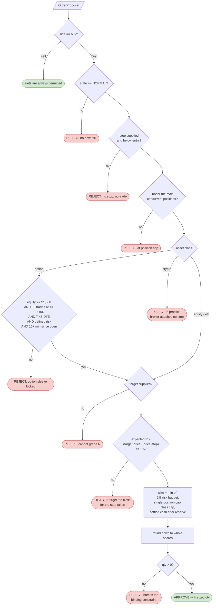
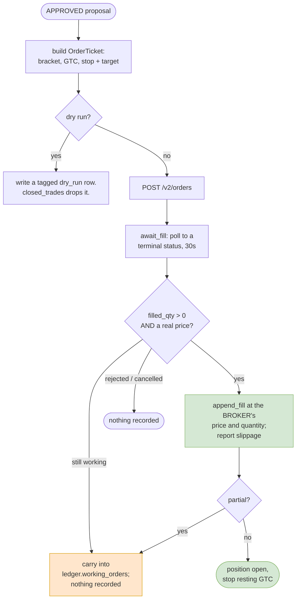
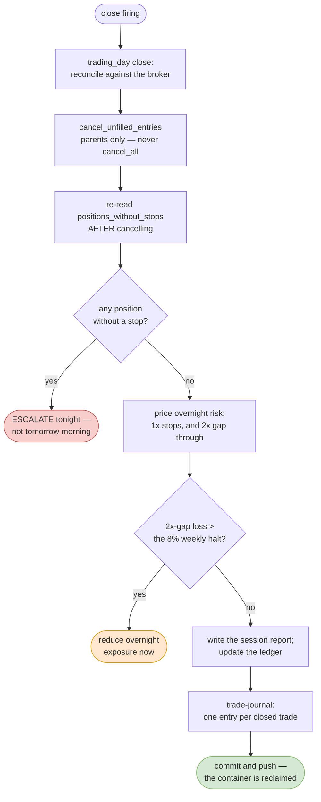

# Session flow — what happens at each firing

Four firings per trading day, each bounded by the mechanical spine. The rule
that shapes every diagram below: **the model decides what to trade, code
decides whether it is allowed.** Wherever a diamond is drawn, the test behind
it is deterministic code in `engine/`, not a judgement.

Rendered by GitHub directly. To regenerate the images:
`npx -y @mermaid-js/mermaid-cli -i docs/12-session-flow.md -o docs/flow.svg`

---

## 1. The day, end to end

---

## 2. The open firing, in detail

The only firing that may open new risk.

---

## 3. The risk gate — every order passes through here

This is the part that may not be bypassed, reasoned around, or satisfied by
reshaping an order until it fits. A rejection is recorded and the session
moves on.

---

## 4. Submission and recording — submitting is not filling

The half that had never executed, and where two of the three critical bugs
found on 2026-09-18 were living.

---

## 5. The close firing

---

## Why the diagrams stop where they do

Each one ends at a commit or a stop. That is deliberate: the container is
ephemeral and is reclaimed after the session, so anything not pushed to the
repository did not happen. `state/` is tracked in git for exactly this reason
— see `docs/04-lessons.md`, 2026-09-15, "The circuit breakers reset overnight
in the configuration we were about to run".
